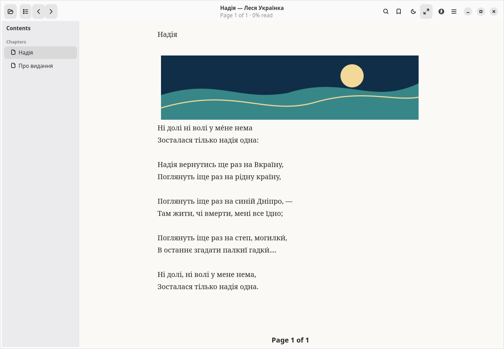
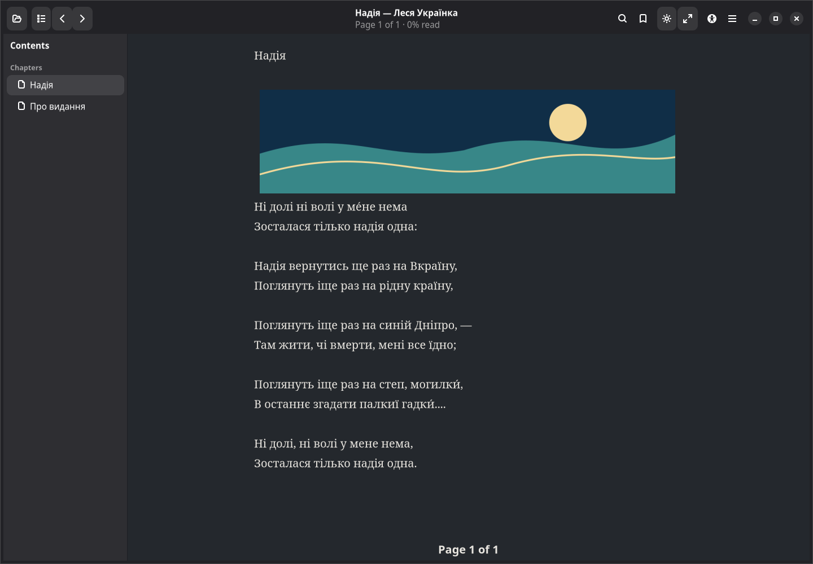
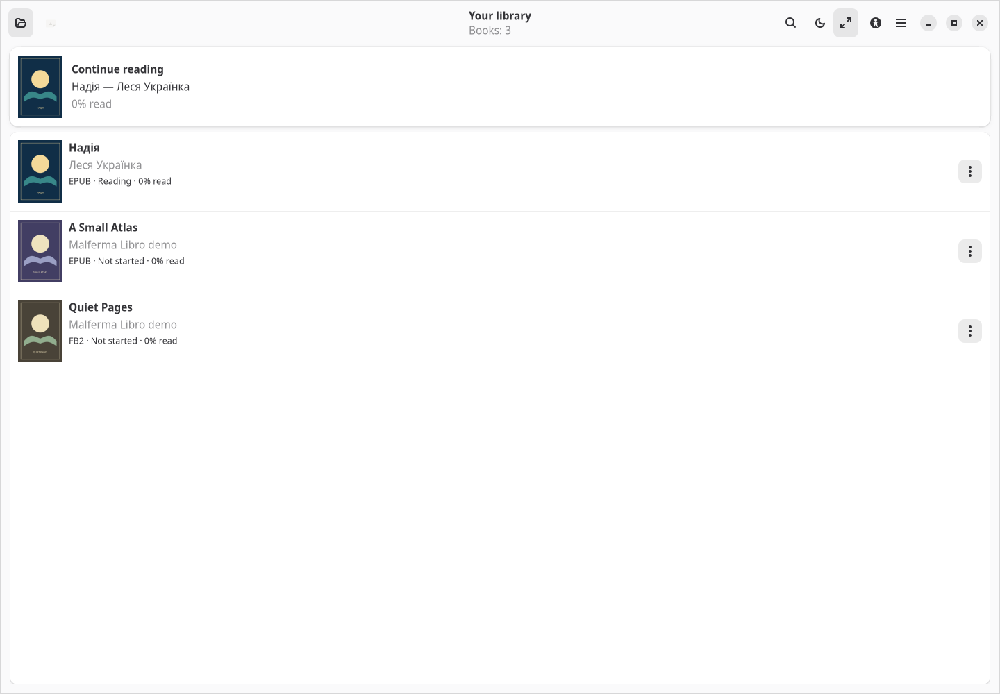

# Malferma Libro

**0.1.1 · Debian 13 · GTK 4 / libadwaita · GPL-3.0-or-later**

A free and open-source desktop ebook reader with a local library and support
for OPDS catalogs. The book occupies most of the window; the table of contents
opens in a sidebar, and reading tools are grouped in the top bar.

Supported formats: EPUB, FB2 and FB2.ZIP, TXT, PDF, DjVu, HTML/XHTML, Markdown
and CBZ. Features include bookmarks and notes, search, light and dark modes,
font settings, page numbering across the entire book, fullscreen mode,
keyboard navigation, mouse gestures and accessibility tools. The interface
supports 49 languages and writing variants; language changes take effect
without restarting the application.

EPUB and FB2 books show text with embedded illustrations. Select an illustration
to open a larger view with zoom controls. The original CSS layout and interactive
content are not reproduced. Search and narration in PDF/DjVu files depend on
the availability of a text layer. OCR and DRM are not supported. CBZ files
are displayed as a sequence of images.

The source code is available at
[gagafes/malferma-libro](https://github.com/gagafes/malferma-libro), on the `main` branch.
To download the source without Git, choose **Code → Download ZIP**.

## Screenshots

Actual application windows captured on Debian 13 at 100% scale.
The sample book is Lesya Ukrainka's *Надія* in the original Ukrainian.



<details>
<summary>Night mode and the local library</summary>

**Night mode**



**Local library with covers**



</details>

[Capture environment, sample content and reproduction instructions](docs/screenshots/README.md).

## Installation and launch

**[Download Malferma Libro 0.1.1-2 for Debian (.deb)](https://github.com/gagafes/malferma-libro/releases/download/v0.1.1-2/malferma-libro_0.1.1-2_all.deb)**

Debian package **0.1.1-2** fixes GTK compatibility on Debian 13 and keeps library
covers and the continue-reading card compact. It also includes the security
fixes and development attribution from 0.1.1-1, documented in the
[security review](docs/SECURITY_REVIEW.md). The application version remains
**0.1.1**. This development prerelease upgrades earlier 0.1.1 packages;
previous release files remain unchanged. The
[release page](https://github.com/gagafes/malferma-libro/releases/tag/v0.1.1-2)
also provides the matching complete source archives and `SHA256SUMS`.

From the folder where you saved the DEB package, run:

```sh
sudo apt install ./malferma-libro_0.1.1-2_all.deb
malferma-libro
```

If you build locally, the generated package is in `dist/`; install it from
that directory or include `dist/` in the package path.

Development builds are also available after a successful GitHub Actions run: open
[Actions](https://github.com/gagafes/malferma-libro/actions), select a green
**Check and build** run, then download `malferma-libro-current` from the
**Artifacts** section. You must be signed in to GitHub to download the artifact.
The ZIP contains the DEB package, source archives and `SHA256SUMS`.

If an earlier build with a higher version number is installed, APT may report
a downgrade: this development series began at **0.1.0** by the project owner's decision.

To run from source on Debian 13:

```sh
sudo apt install python3 python3-gi gir1.2-gtk-4.0 gir1.2-adw-1 \
  python3-markdown-it poppler-utils djvulibre-bin librsvg2-common
make run
```

The application uses the system `/usr/bin/python3` so that PyGObject dependencies
installed through APT are available. It follows the system font, scaling and
symbolic icons; GTK/libadwaita appearance depends on the desktop environment
and installed themes.

Narration uses **Piper** exclusively. The engine and voice models must be
installed separately; they are not included in this DEB package or source archive.
See the [user guide](docs/MANUAL.en.md#narration) and
[voice licensing notes](PIPER_LICENSES.md).

## Documentation

- User guide: [Russian](MANUAL.md), [English](docs/MANUAL.en.md),
  [German](docs/MANUAL.de.md), [Ukrainian](docs/MANUAL.uk.md).
- Command-line help: `malferma-libro --help`, `--manual`, `--manual=en`,
  `--version` and `--license`. These commands work without a graphical session.
- Man page: `man malferma-libro`, with `man-db` installed.
- Recovery notes: [English](docs/RECOVERY.en.md), [Russian](RECOVERY.md);
  [validation scope](VALIDATION.md).

## Development and building

Install `dpkg-dev` to build the DEB package. The build does not download
dependencies from the network.

```sh
make test
make translations
make release
```

`make release` creates the DEB package and complete source archives in ZIP
and TAR.GZ formats. Separate targets are available: `make deb` and `make source`.
For reproducible builds, set `SOURCE_DATE_EPOCH`; the default is `0`.

```text
src/malferma_libro/  application and bundled resources
po/                 editable translation catalogs
tests/              tests reconstructed for the current project
data/               desktop/AppStream files, icons and man pages
docs/               translated user guides
packaging/          shared build script and licensing information
dist/               build output, excluded from Git
```

The project directory is named `malferma-libro`; the Python package is
`malferma_libro`. The application is named **Malferma Libro**, and its only
launch command is `malferma-libro`. The stable application ID is retained
for compatibility with installed icons and desktop integration.

See [CONTRIBUTING.md](CONTRIBUTING.md#working-with-github) for instructions
on contributing changes and working with the GitHub repository.

The scope, corrections and limits of the source security review are recorded
in [Security review](docs/SECURITY_REVIEW.md).

## Development attribution

Developed with assistance from **OpenAI Codex**. Project concept, requirements,
and direction: **Andrey Popovich**.

## License

Code, translations and documentation: [GNU GPL v3 or later](LICENSE).
The logo uses the same license, with [permission confirmed by its owner](LOGO_LICENSE.md).
The nine bundled fonts retain their [SIL OFL 1.1](FONT_LICENSES.md) licenses;
AppStream metadata is licensed under CC0-1.0. System dependencies and voice
models retain their own license terms. See [LICENSE_AUDIT.md](LICENSE_AUDIT.md).
