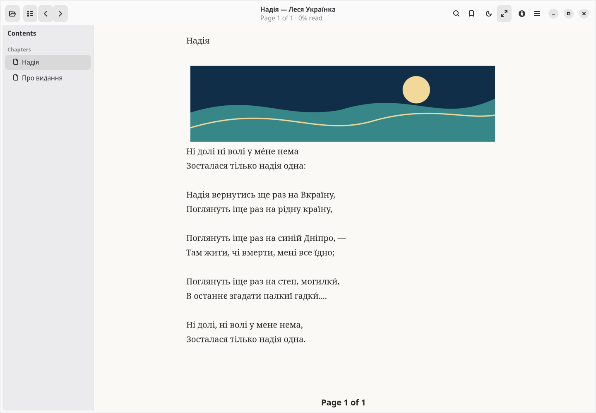

# Malferma Libro

Open-source GTK 4 / libadwaita ebook reader for Debian 13 and Ubuntu 24.04, with a local library and OPDS catalogs.

- **Formats** — EPUB, FB2/FB2.ZIP, TXT, PDF, DjVu, HTML/XHTML, Markdown and CBZ.
- **Reading** — bookmarks, notes, search, adjustable fonts, themes, fullscreen, keyboard and mouse controls, and accessibility tools. EPUB and FB2 support zoomable illustrations. The interface supports 49 languages and writing variants.
- **Limits** — PDF/DjVu search and narration require a text layer. OCR and DRM are unsupported. Narration requires [Piper and voice models](docs/MANUAL.en.md#narration), installed separately.

## Installation and launch

[Download DEB 0.1.2-1](https://github.com/gagafes/malferma-libro/releases/download/v0.1.2-1/malferma-libro_0.1.2-1_all.deb) · [Release notes, source archives and SHA256SUMS](https://github.com/gagafes/malferma-libro/releases/tag/v0.1.2-1)

```sh
sudo apt install ./malferma-libro_0.1.2-1_all.deb
malferma-libro
```

Run these commands from the download directory. Library data lives in `$XDG_DATA_HOME/malferma-libro` (usually `~/.local/share/malferma-libro`).

## Run from source

```sh
sudo apt install python3 python3-gi python3-markdown-it python3-defusedxml \
  gir1.2-gtk-4.0 gir1.2-adw-1 poppler-utils djvulibre-bin librsvg2-common
make run
```

`make check` runs tests and checks translations. With `dpkg-dev` installed, `make release` writes the DEB, source archives and checksums to `dist/`.

## Documentation

- User guides in [English](docs/MANUAL.en.md), [Russian](MANUAL.md), [German](docs/MANUAL.de.md) and [Ukrainian](docs/MANUAL.uk.md).
- CLI reference via `malferma-libro --help`, `malferma-libro --manual=en` or `man malferma-libro`.
- [Recovery](docs/RECOVERY.en.md) · [Validation](VALIDATION.md) · [Security review](docs/SECURITY_REVIEW.md) · [Contributing](CONTRIBUTING.md) · [More screenshots](docs/screenshots/README.md)



[GPL-3.0-or-later](LICENSE) · [Asset and dependency licenses](LICENSE_AUDIT.md)

Project by Andrey Popovich, developed with assistance from OpenAI Codex.
