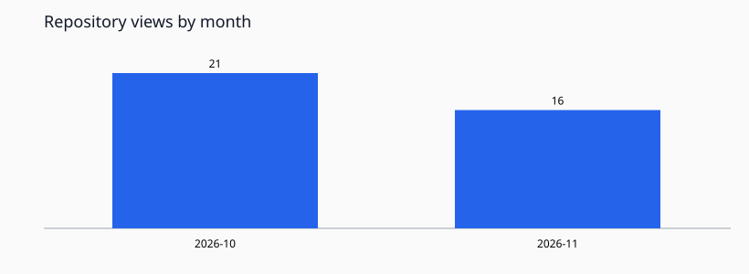
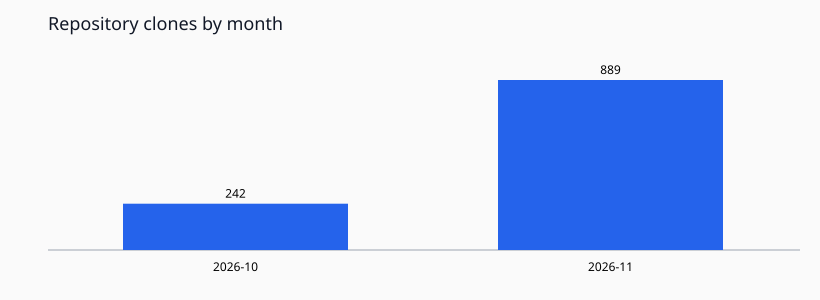
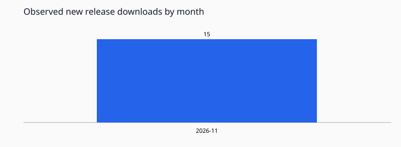

# GitHub statistics — gagafes/malferma-libro

**Updated (UTC):** 2026-11-07T07:13:27+00:00  
**Traffic API:** not configured (TRAFFIC_READ_TOKEN missing)

## Monthly graphs

## Monthly totals

| Month (UTC) | Views | Clones | Observed new downloads |
|---|---:|---:|---:|
| 2026-11 | — | — | 15 |

## Release assets: current download counters

| Release | Asset | Downloads |
|---|---|---:|
| v0.1.1-4 | malferma-libro_0.1.1-4_source.zip | 0 |
| v0.1.1-4 | malferma-libro_0.1.1-4_source.tar.gz | 0 |
| v0.1.1-4 | malferma-libro_0.1.1-4_all.deb | 37 |
| v0.1.1-4 | SHA256SUMS | 0 |

## Raw data and limitations

- [Daily CSV](daily.csv) / [Complete JSON history](history.json).
- GitHub supplies traffic for the rolling last 14 days. Daily snapshots here preserve earlier days.
- Monthly view/clone event totals are sums of daily figures, NOT unique monthly users.
- Download changes are measured between saved snapshots. The first observation
  of each release asset is a baseline, not a historical daily count.
- Missing snapshot dates cannot be reconstructed precisely. Deleted assets are absent from
  current release download totals; auto-generated GitHub source archives are not included.
- All dates use UTC. No personal access tokens are written into these files.
